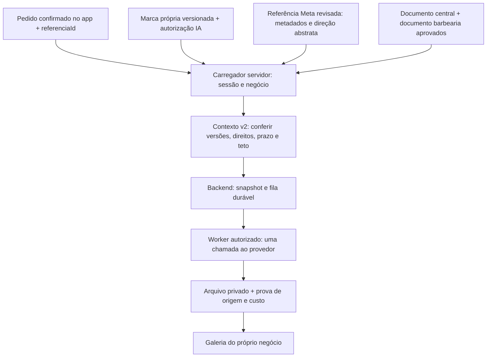

# 05/06 — Contexto de criação com referência pública v2 (26/10/2026)

## §0. Estado e próximo portão

**Bloco local entregue; geração real não liberada.** Recorte humano vigente: identidade autorizada do cliente + referência escolhida da Biblioteca de Anúncios. Pinterest não é requisito deste recorte. O corte Jev de 80% é pertinência ao serviço de barbearia, sem provar vendas, qualidade ou direito de reprodução.

O próximo piloto é **uma imagem**, depois de os responsáveis comprovarem os pontos abaixo. Não é necessário Victor repetir decisões de produto já tomadas.

| Condição para liberar o piloto | Responsável | Situação nesta prova |
|---|---|---|
| Logo vigente, SHA-256 dos bytes, versão da marca, cores e autorização específica/revogável para IA | 03/04 + fonte de contexto | Pendente de fonte persistida consumível. O handoff recebido informa que o upload sozinho não concede essa autorização. Alterações em andamento em outro chat foram preservadas. |
| Referência escolhida com ID, versão, classificação/pertinência reais, orientação abstrata revisada, condição de uso e revisão identificada | Curadoria + 07/08 | Catálogo local tem IDs públicos. Os registros dos testes deste bloco são fictícios; não aprovaram as dez referências para geração. |
| Documento central e documento de barbearia efetivamente revisados e versionados, acessíveis ao carregador | Victor/revisor de conteúdo + 07/08 | Os modelos existentes não substituem conteúdo aprovado. Nicho técnico `barbearia` deve coincidir no carregador e no pedido. |
| Carregador servidor relendo registros/revogação e conferindo o hash canônico de marca/contexto | 07/08 | Manifesto validado contra o Pydantic atual, offline. Persistência, convenção dos hashes e injeção no serviço ainda precisam de prova integrada; não foram implementadas neste repo. |
| Fila/worker e arquivo comprovarem pedido v2, ID público escolhido, versões de marca/contexto e hashes | 07/08 + 05/06 | Veto de v2 mantido e ampliado para consulta/arquivo. DTO/metadata v1 não bastam para essa prova. |
| Schema/Storage/serviço QA, sessão humana e isolamento autenticado | Central + 07/08 | Não ensaiados nesta rodada; nenhuma migration, flag ou painel foi alterado. |
| Material/negócio do piloto, provedor e teto nominal para uma chamada paga | Victor | Portão específico posterior. Nenhuma chamada paga foi feita aqui. |

Não retirar o veto só porque o Pydantic aceita o formato. Antes disso, testar pedido → carregador persistido → snapshot v2 → execução controlada → arquivo privado → galeria, incluindo troca de referência, marca alterada e autorização revogada.

## Fatos mapeados antes de implementar

- `lib/criativos/pedido-imagem.ts` já inclui `referenciaId` no hash imutável do payload v2. A migration `20261026193000_referencia_publica_pedido_criativo.sql` é local e não foi aplicada por este bloco.
- O montador legado `lib/criativos/geracao/triangulo-contexto.ts` já tinha duas classes de material, mas aceitava pedido v2 sem vincular o ID escolhido ao arquivo da referência. Ele agora recusa v2 explicitamente (`:117`).
- O backend encontrado ao reler `src/imagem/geracao_contrato.py` **já tinha** `ReferenciaPublicaGeracao`, `EvidenciasContextoV2` e `versao_contexto=2`. Portanto não se criou um contrato alternativo no backend. Nenhum arquivo de 07/08 foi editado.
- Nesse contrato v2, há um logo em `materiais` e uma `referencia_publica` textual com `permite_copiar=false`. `pedido_visual` inclui a orientação abstrata e a regra de não buscar a URL nem copiar foto, marca ou texto do anunciante.
- A biblioteca existente usa a rota privada para os bytes gerados. Selecionar uma referência pública não autoriza armazenar ou enviar a imagem do concorrente ao gerador.

## O que foi implementado

1. **Montador v2 server-only:** `lib/criativos/geracao/contexto-referencia-publica.ts:87`. Recebe entradas de um futuro carregador confiável, não de formulário/HTTP. Não faz SQL, download, chamada ao Jev, n8n ou provedor.
2. **Vínculo verificável:** marca e contexto revisados ligam `business_id`, pedido, autor, hash do pedido, ID público escolhido, versões, revisores, cores, logo/hash/autorização, documentos, política e autorização/teto do piloto. Mudança deixa a aprovação anterior divergente. Revisões revogadas, de outro negócio/pedido ou anteriores aos insumos são recusadas.
3. **Duas fontes separadas:** logo próprio autorizado é o único arquivo no manifesto. A referência entra por metadados e direção visual abstrata revisada; o objeto não aceita campo extra para imagem/caminho. Não há coleta ou reprodução de concorrente. Fachada/fotos adicionais permanecem fora deste contrato v2, que hoje limita os materiais a um logo; se necessárias ao criativo, precisam de recorte compatível e material próprio autorizado.
4. **Compatibilidade local:** a saída satisfaz o `ContextoAprovado` v2 real do backend, e o hash JS do pedido coincide com `hash_do_pedido` Python. A regra gerada por `pedido_visual` proíbe copiar o anunciante. Isso prova forma e consistência offline, não a existência de registros aprovados no banco.
5. **Sem falso sucesso:** `app/(protected)/criativos/geracao-actions.ts:50` relê o pedido antes das operações. Pedido ausente/falha da consulta retorna aviso normalizado sem HTTP; v2 retorna `contexto_pendente` também ao consultar/cancelar. `lib/criativos/geracao/imagem-privada.ts:37` relê autoria e versão antes de consultar backend/Storage: v2 não abre arquivo v1 como se comprovasse a referência.
6. **Reuso das validações:** pedido, documentos, cores, custo e material autorizado compartilham conferência com o legado. O fluxo v1 com referência em arquivo licenciada continua separado; não converte pedido v2 silenciosamente.

`RegistroRevisado<T>` é um contrato de entrada, **não uma tabela criada**. `hashRegistroContexto` usa o JSON canônico já existente (`canonico`) e SHA-256. Os hashes detectam mudança; não são assinatura de pessoa, consentimento ou prova de persistência. A convenção precisa ser consumida/reconferida pelo carregador de 07/08 antes da integração real.

## Caminho dos dados e lugar dos documentos/n8n



O desenho acima é o caminho de integração; nesta rodada só o montador e os vetos foram implementados/testados. As ligações persistidas não estão comprovadas.

| Dado | Fonte hoje / destino necessário | Quando entra |
|---|---|---|
| Pedido e referência escolhida | `creative_generation_requests.payload` v2, sob sessão/RLS | Na confirmação do pedido; não alterar o mesmo ID para escolher outra referência. |
| Logo e cores | `creatives` e `businesses.onboarding.marca`, complementados por versão/hash/autorização persistida | Ao montar o contexto; reler a versão vigente e revogação antes de permitir execução. |
| Referência | `lib/jev/catalogo-barbearia.ts` hoje contém IDs/datas; precisa de registro revisado persistente | Após seleção; carregar exatamente o ID confirmado, sem escolher um vizinho silenciosamente. |
| Regras central/nicho | Modelos `docs/criativos-base-central.md` e `docs/criativos-modelo-nicho.md`; conteúdo aprovado precisa estar acessível/versionado no servidor | Na montagem do contexto, antes da reserva/submissão, com conteúdo e versão congelados no snapshot. Não enviar esses MDs ao Jev como se fossem classificação. |
| Origem do arquivo final | Job/snapshot e `creatives.copy.generation`, associados ao arquivo privado | Após execução; prova de v2 precisa sobreviver a recarga e troca de negócio. Não inventar esse vínculo na interface. |

**n8n:** a execução de classificação é uma etapa de curadoria separada da geração. No desenho, recebe somente amostra autorizada, preserva ID/origem/data, registra classificação/versão/custo e encaminha à revisão. Na geração, pode orquestrar um chamado ao backend autorizado; sessão, direitos, contexto congelado, idempotência, orçamento e worker continuam sob validação do backend. Não gerar diretamente a partir de FormData nem repetir chamada paga quando o resultado ficou incerto.

O workflow histórico `3kfUlXxPnKRDMB60` foi registrado inativo em `criativos-n8n-mapa-piloto-19-10.md`. **Não foi relido ou alterado nesta rodada**; não se afirma seu estado remoto atual. Caminho local de MD não é fonte remota já conectada ao n8n. Não se criou webhook/agendamento nem se ativou integração.

## Prova executada neste bloco

Um comando de testes dirigido ao risco novo e às rotas afetadas:

```text
node --test scripts/conferir-contexto-referencia-publica.mjs scripts/conferir-triangulo-contexto-real.mjs scripts/conferir-geracao-real-leitura-local.mjs scripts/conferir-ui-fila-geracao-local.mjs scripts/conferir-dispatch-real-webapp-local.mjs
```

**43/43 passaram**: contexto v2 (10), contexto legado (7), leitura real instrumentada (9), fila fake integrada (11), dispatcher real com provedor substituído (6). `pnpm typecheck` passou; `git diff --check` sem erro de whitespace.

Os dados, aprovações, revisores e pontuação de 80% desses testes são **fictícios**. Os valores monetários minúsculos verificam precisão decimal; não são preços. O Python usado na compatibilidade recebeu ambiente reduzido, sem credenciais de provedor. O ensaio integrado de fila roda em PostgreSQL efêmero e usa substituto de provedor; os bytes não são criação de IA real.

Não houve alteração de tela/estilo, prova visual nova, QA autenticado, chamada paga, publicação, Meta, configuração externa, migration remota, commit, push ou deploy. Outros chats alteraram onboarding/Conta/identidade/handoffs durante a execução; essas alterações não são desta entrega e foram preservadas. Índice e decisões compartilhados não foram editados neste bloco; a integração do checkpoint fica com o Central.
